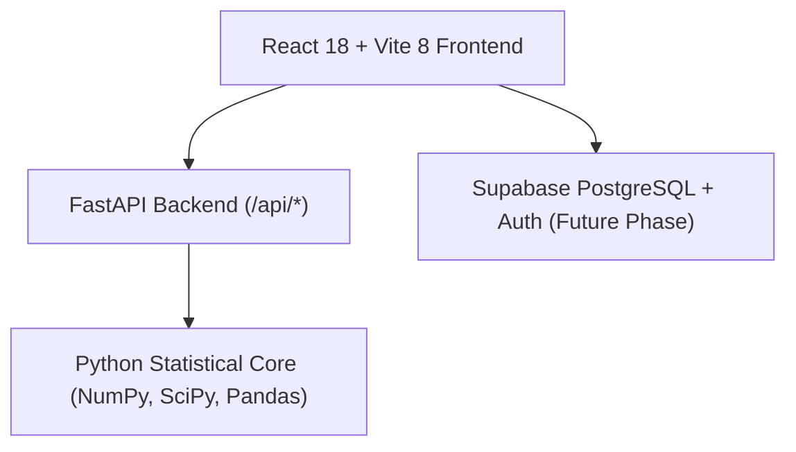

# NETPULSE Architecture Specification
**Course:** Probability and Statistics for Computer Science (25CS203)

---

## 1. System Overview
NETPULSE bridges educational gaming ("Mode 1: Learn & Play") and rigorous statistical telemetry analysis ("Mode 2: Technical Lab") through a unified Python statistical engine.

---

## 2. Python Statistical Core Services (`backend/services/`)

| Module | Core Functions | Mathematical Basis |
| :--- | :--- | :--- |
| `statistics.py` | `calculate_mean`, `calculate_variance`, `calculate_std_dev`, `calculate_z_score` | NumPy $\bar{x}$, $s^2$ (Bessel's correction $ddof=1$), $s$, $Z = (X - \mu)/\sigma$, zero-variance guard |
| `probability.py` | `calculate_cdf`, `calculate_upper_tail`, `calculate_interval_probability`, `generate_normal_pdf_coordinates` | SciPy `scipy.stats.norm` CDF, survival function (SF), interval subtraction, PDF coordinates |
| `anomaly.py` | `classify_z_score`, `is_anomaly`, `detect_anomalies_in_dataset` | Project thresholds: $Z < -2.0$ (Low), $[-2.0, +2.0]$ (Normal), $Z > +2.0$ (High) |
| `health.py` | `calculate_health_score`, `get_health_band`, `evaluate_network_health` | $H = \max(0, \min(100, 100 - 25 \times \max(0, |Z| - 1)))$ (5 status bands) |
| `explanation.py`| `explain_mean`, `explain_z_score`, `explain_probability`, `build_full_explanation` | Deterministic rule-based formula substitution and interpretation |
| `simulator.py` | `simulate_load_point`, `generate_what_if_sweep` | Dynamic What-If slider evaluator and Gaussian empirical marker generator |

---

## 3. The Golden Bridge
Every educational game scenario produces a structured telemetry payload. When a player resolves a challenge, a `[View Technical Analysis]` link transfers the exact parameters into the Technical Lab, plotting the corresponding Gaussian curve and explaining the formula step-by-step.

---

## 4. Frontend Architecture & Design System (Phase 4)

### 4.1 UI Stack
- **Framework:** React 18 + Vite 8
- **Styling:** Tailwind CSS 4 with `@tailwindcss/vite` integration (`@import "tailwindcss";`, custom `@theme` tokens)
- **Routing:** React Router v7 (`react-router-dom`)
- **Charting:** Recharts
- **Icons:** Lucide React

### 4.2 Reusable Component Architecture (`frontend/src/components/`)
- `Navbar.jsx`: Application header with real-time FastAPI heartbeat probe, mobile hamburger toggle, guest status indicator.
- `Sidebar.jsx`: Collapsible navigation drawer categorized into Overview, Learn & Play, Technical Lab, Learn, and Account; auto-closes on mobile navigation.
- `Layout.jsx`: Responsive layout container managing sidebar state and footer.
- `PageHeader.jsx`: Standardized page header with mode badges, title, subtitle, and action buttons.
- `MetricCard.jsx`: Metric display card with low-contrast borders, accent colors, unit labels, and icons.
- `StatusBadge.jsx`: Semantic status indicators for `NORMAL`, `UNUSUALLY LOW`, `UNUSUALLY HIGH`, `HEALTHY`, `WARNING`, etc.
- `Panel.jsx`: Reusable container panel with header, subtitle, icon, and action slots.
- `LoadingState.jsx`: Accessible loading indicator with status text.
- `ErrorState.jsx`: Actionable error panel with retry button and connection guidance.
- `EmptyState.jsx`: Informative empty placeholder for tables, charts, or lists.
- `NetworkTrendChart.jsx`: Responsive time-series area chart displaying actual campus telemetry loads with $\mu$ and $+2\sigma$ reference lines.

### 4.3 Route Manifest
All 15 approved routes + 404 fallback:
- `/` — Home (NOC overview, live telemetry cards, trend chart, mode gateways)
- `/dashboard` — NOC Command Dashboard (surveillance log, real anomaly triage, load trends)
- `/learn-and-play` — Gaming Suite (5 curriculum missions, Golden Bridge concept)
- `/technical-lab` — Statistical Telemetry Workbench (connected to `POST /api/analyze`)
- `/distribution-explorer` — Gaussian Modeling & 68-95-99.7 Empirical Guide
- `/probability-lab` — Cumulative Gaussian Solver (connected to `POST /api/probability`)
- `/zscore-analysis` — Standardized Score Normalization & 3-zone threshold rules
- `/what-if-simulator` — Dynamic Load Sweeper (connected to `POST /api/simulation`)
- `/learning-center` — Structured 7-topic curriculum with Viva exam checks
- `/achievements` — Student achievements catalog (locked, awaiting Phase 9)
- `/leaderboard` — Class standings table (empty state, awaiting Phase 9)
- `/analysis-history` — Historical analysis audit log (empty state, awaiting Phase 7)
- `/login` — Operator authentication form (Phase 8 architecture notice)
- `/register` — Student profile registration form (Phase 8 architecture notice)
- `/profile` — Student analyst profile (guest state, course metadata)
- `*` — 404 Route Not Found page

### 4.4 Technical Lab Architecture (Phase 5)
- `GaussianBellChart.jsx`: Reusable Recharts Gaussian Bell visualizer plotting 60 discrete continuous PDF coordinates from SciPy, vertical reference lines for $\mu$, $\pm 1\sigma, \pm 2\sigma, \pm 3\sigma$, dynamic load pin, and custom telemetry tooltip.
- `TechnicalLab.jsx`: Primary analysis workbench querying `POST /api/analyze` and `GET /api/dataset`, rendering moments ($\bar{x}, s^2, s$), $Z$-score, CDF/SF probabilities, status badge, health rating, and plain-English explanation.
- `DistributionExplorer.jsx`: Gaussian modeling workspace with empirical 68-95-99.7% intervals, academic modeling notes, and interactive load positioner.
- `ProbabilityLab.jsx`: Tail and interval calculator supporting $P(X \le x)$, $P(X \ge x)$, and $P(a \le X \le b)$ backed by SciPy CDF.
- `ZScoreAnalysis.jsx`: Standardized score inspector with visual horizontal axis ($-3\sigma$ to $+3\sigma$), 3-zone classifier, and arithmetic substitution cards.
- `WhatIfSimulator.jsx`: Dynamic load sweeper with dual synchronized inputs (slider and numeric box), debounced API integration, real-time bell curve updating, telemetry guidance, and health formula explanation.

### 4.5 Learn & Play Gaming Architecture (Phase 6)
- `LearnAndPlay.jsx`: Mission Operations Lobby displaying 5 curriculum game cards with objectives, difficulty levels, mathematical focuses, and live in-memory session stats (Session XP, accuracy %, missions completed).
- `TrafficControllerGame.jsx` (Game 1): Real-time surge triage scenario (`traffic_controller_01`) testing incident response against baseline moments.
- `ZScoreChallengeGame.jsx` (Game 2): Standardization puzzle (`zscore_challenge_01`) testing calculation of $Z = (X - \mu) / \sigma$ with numeric decimal entry.
- `NormalCurveGame.jsx` (Game 3): Interactive Gaussian bell curve marker locator (`normal_curve_01`) testing standard deviation boundaries ($\pm 2\sigma$) using live curve coordinates.
- `AnomalyHunterGame.jsx` (Game 4): Sampled packet series scanner (`anomaly_hunter_01`) identifying statistical outliers violating the $\pm 2.0\sigma$ threshold.
- `EmergencyMissionGame.jsx` (Game 5): Staged 3-step cyber defense simulation (`emergency_mission_01`) covering Z-score calculation, state classification, and protocol deployment.
- `GameResultCard.jsx`: Reusable verdict panel providing authoritative correctness status, correct answers, natural language reasoning, ground truth metrics, and the Golden Bridge button (`[View Technical Analysis]`).
- `GameContext.jsx`: Ephemeral session state manager with interaction deduplication preventing duplicate reward exploitation.

### 4.6 Database Persistence & Storage Architecture (Phase 7)
- `supabase/`: Idempotent SQL migrations (`001_initial_schema.sql`, `002_rls_and_storage.sql`), master schema (`schema.sql`), repeatable achievement seeds (`seed.sql`), and transaction-safe security tests (`tests/rls_validation.sql`).
- `profiles`: User account metadata linked 1:1 with `auth.users(id)` with auto-updating timestamps.
- `game_results`: Authoritative mission telemetry and scores awarded by the backend.
- `achievements` & `user_achievements`: Master catalog with public visibility and isolated per-user unlock records.
- `analysis_history`: High-precision statistical audit snapshots preserving mean, variance, standard deviation, Z-score, CDF probability, and health scores.
- `datasets`: Custom telemetry file registry linking user uploads to the private `network-datasets` Storage bucket (`<auth.uid()>/<filename>`).
- `services/`: Modular persistence service layer (`profileService`, `analysisHistoryService`, `gameResultsService`, `achievementService`, `datasetService`) using central `supabase.js` client with configuration validation (`isSupabaseConfigured`).

### 4.7 Authentication & User Profiles Architecture (Phase 8)
- `AuthContext.jsx`: Central authentication provider managing user session lifecycle, persistent authentication across page refreshes via `supabase.auth.getSession()` and `supabase.auth.onAuthStateChange()`, reactive `profile` state, error handling, and guest fallback when Supabase is not configured.
- `ProtectedRoute.jsx`: Reusable route wrapper protecting authenticated-only views (`/profile`, `/analysis-history`), preserving intended location (`location.state?.from`) during redirect to `/login`.
- `Register.jsx`: Student analyst registration form with validation, minimum password strength requirements, username uniqueness, and post-signup email confirmation prompt.
- `Login.jsx`: Secure sign-in form with toggleable password visibility, inline error reporting, and automatic redirect back to original destination.
- `Profile.jsx`: Authenticated student dashboard displaying operator callsign, unique account ID, verification status, member tenure, server-authoritative level and XP, custom callsign updater (`updateCallsign`), and sign-out controls.
- `Navbar.jsx` & `Sidebar.jsx`: Synchronized authentication indicators showing real-time callsign badges, quick links to profile, and contextual sign-out buttons.
- `supabase/migrations/003_auth_profiles_trigger.sql`: Automatic database trigger `on_auth_user_created` executing `public.handle_new_user()` to guarantee immediate 1:1 `profiles` record creation upon student registration.
- `profileService.getOrCreateProfile`: Client-side reconciliation layer guaranteeing that even if a trigger is delayed, a matching profile record is created and linked safely.
