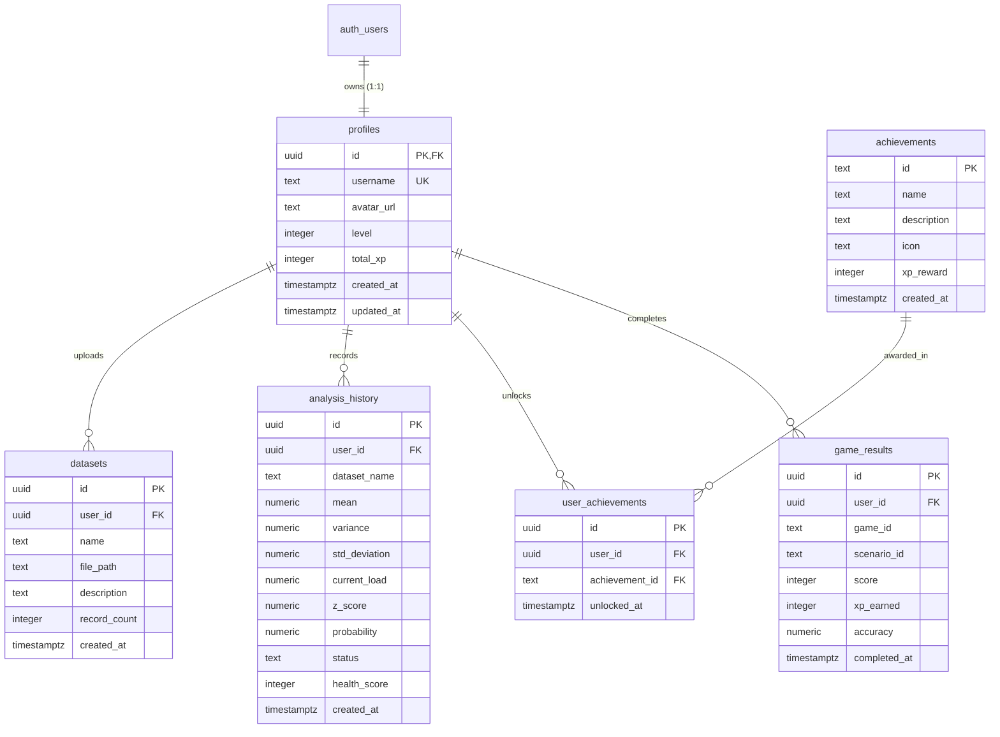

# NETPULSE Database Specification & Security Architecture
**Course:** Probability and Statistics for Computer Science (`25CS203`)  
**Provider:** Supabase (PostgreSQL 15+ & Supabase Storage)

---

## 1. Overview & System Boundary

NetPulse uses Supabase PostgreSQL for structured relational persistence and Supabase Storage for private user dataset files.

> **Computational Authority Boundary:**  
> All statistical metrics (mean, sample variance, standard deviation, Z-scores, normal CDF/SF probabilities, anomaly classifications, and health scores) are computed exclusively by the Python FastAPI engine (`NumPy`, `SciPy`, `Pandas`). The database acts strictly as a persistent audit and records repository; it never recalculates or substitutes statistical results.

---

## 2. Table Specifications & Constraints



### 2.1 `profiles` Table
Stores student analyst credentials linked directly to Supabase Auth (`auth.users`).
- `id` (`UUID`, Primary Key): Foreign key referencing `auth.users(id) ON DELETE CASCADE`.
- `username` (`TEXT`, Unique, Not Null): Student operator callsign.
- `avatar_url` (`TEXT`): Avatar identifier (defaults to `'default_avatar'`).
- `level` (`INTEGER`, Default `1`, Check: `level >= 1`): Progression tier.
- `total_xp` (`INTEGER`, Default `0`, Check: `total_xp >= 0`): Cumulative verified experience points.
- `created_at` (`TIMESTAMPTZ`, Default `NOW()`): Account timestamp.
- `updated_at` (`TIMESTAMPTZ`, Default `NOW()`): Managed via trigger `trigger_profiles_updated_at`.

### 2.2 `game_results` Table
Records outcomes of curriculum simulations from the Learn & Play gaming suite.
- `id` (`UUID`, Primary Key, Default `gen_random_uuid()`): Unique result identifier.
- `user_id` (`UUID`, Foreign Key, Not Null): References `profiles(id) ON DELETE CASCADE`.
- `game_id` (`TEXT`, Not Null): e.g. `'traffic_controller'`, `'zscore_challenge'`, etc.
- `scenario_id` (`TEXT`): Educational scenario identifier (e.g. `'traffic_controller_01'`).
- `score` (`INTEGER`, Default `0`, Check: `score >= 0`): Session points.
- `xp_earned` (`INTEGER`, Default `0`, Check: `xp_earned >= 0`): Authoritative XP returned by backend.
- `accuracy` (`NUMERIC(5, 2)`, Default `0.00`, Check: `0.00 <= accuracy <= 100.00`): Percentage accuracy.
- `completed_at` (`TIMESTAMPTZ`, Default `NOW()`).

### 2.3 `achievements` Table
Public master registry of curriculum milestone badges.
- `id` (`TEXT`, Primary Key): Canonical achievement slug (e.g. `'first_analysis'`).
- `name` (`TEXT`, Not Null): Human-readable achievement title.
- `description` (`TEXT`, Not Null): Criteria for unlocking the achievement.
- `icon` (`TEXT`, Not Null): Lucide React icon name.
- `xp_reward` (`INTEGER`, Default `50`, Check: `xp_reward >= 0`): XP bonus.
- `created_at` (`TIMESTAMPTZ`, Default `NOW()`).

### 2.4 `user_achievements` Table
Join table mapping students to unlocked badges.
- `id` (`UUID`, Primary Key, Default `gen_random_uuid()`).
- `user_id` (`UUID`, Foreign Key, Not Null): References `profiles(id) ON DELETE CASCADE`.
- `achievement_id` (`TEXT`, Foreign Key, Not Null): References `achievements(id) ON DELETE CASCADE`.
- `unlocked_at` (`TIMESTAMPTZ`, Default `NOW()`).
- **Constraint:** `UNIQUE(user_id, achievement_id)` prevents duplicate unlock records.

### 2.5 `analysis_history` Table
Immutable audit snapshots of statistical telemetry evaluations.
- `id` (`UUID`, Primary Key, Default `gen_random_uuid()`).
- `user_id` (`UUID`, Foreign Key, Not Null): References `profiles(id) ON DELETE CASCADE`.
- `dataset_name` (`TEXT`, Default `'campus_network'`).
- `mean` (`NUMERIC(10, 4)`, Not Null): Sample mean ($\bar{x}$) in Mbps.
- `variance` (`NUMERIC(10, 4)`, Not Null): Sample variance ($s^2, ddof=1$).
- `std_deviation` (`NUMERIC(10, 4)`, Not Null): Sample standard deviation ($s, ddof=1$).
- `current_load` (`NUMERIC(10, 4)`, Not Null): Throughput observation ($X$) in Mbps.
- `z_score` (`NUMERIC(10, 4)`, Not Null): Standardized distance: $Z = (X - \mu)/s$.
- `probability` (`NUMERIC(8, 6)`, Not Null, Check: `0.0 <= probability <= 1.0`): SciPy Normal CDF $P(X \le x)$.
- `status` (`TEXT`, Not Null): Anomaly classification (`NORMAL`, `UNUSUALLY HIGH`, `UNUSUALLY LOW`).
- `health_score` (`INTEGER`, Not Null, Check: `0 <= health_score <= 100`): Application-level score.
- `created_at` (`TIMESTAMPTZ`, Default `NOW()`).

### 2.6 `datasets` Table
Catalog metadata for custom user telemetry files.
- `id` (`UUID`, Primary Key, Default `gen_random_uuid()`).
- `user_id` (`UUID`, Foreign Key, Not Null): References `profiles(id) ON DELETE CASCADE`.
- `name` (`TEXT`, Not Null): Display name of the dataset.
- `file_path` (`TEXT`, Not Null): Storage path in bucket (e.g. `<user_id>/<timestamp>_<file>.csv`).
- `description` (`TEXT`): User notes.
- `record_count` (`INTEGER`, Check: `record_count >= 0`): Row count.
- `created_at` (`TIMESTAMPTZ`, Default `NOW()`).

---

## 3. Row-Level Security (RLS) Policy Matrix

Row-Level Security is strictly enabled on all six tables. Unauthenticated (`anon`) requests are completely blocked from viewing or mutating user data.

| Table | Operation | Role | Policy Condition | Purpose |
| :--- | :--- | :--- | :--- | :--- |
| `profiles` | SELECT | `authenticated` | `auth.uid() = id` | Read own profile only |
| `profiles` | INSERT | `authenticated` | `WITH CHECK (auth.uid() = id)` | Create own profile only |
| `profiles` | UPDATE | `authenticated` | `auth.uid() = id` | Modify own profile only |
| `profiles` | DELETE | `authenticated` | `auth.uid() = id` | Delete own profile only |
| `game_results` | SELECT | `authenticated` | `auth.uid() = user_id` | Read own game results |
| `game_results` | INSERT | `authenticated` | `WITH CHECK (auth.uid() = user_id)` | Record own game outcomes |
| `achievements` | SELECT | `public` | `true` | Public catalog visibility |
| `achievements` | INS/UPD/DEL | `service_role` | Admin migration only | Prevents client catalog tampering |
| `user_achievements` | SELECT | `authenticated` | `auth.uid() = user_id` | Read own unlocked badges |
| `user_achievements` | INSERT | `authenticated` | `WITH CHECK (auth.uid() = user_id)` | Record badge unlock |
| `analysis_history` | SELECT | `authenticated` | `auth.uid() = user_id` | Read own audit snapshots |
| `analysis_history` | INSERT | `authenticated` | `WITH CHECK (auth.uid() = user_id)` | Save calculation snapshot |
| `datasets` | ALL | `authenticated` | `auth.uid() = user_id` | Full ownership isolation |

---

## 4. Supabase Storage Architecture (`network-datasets`)

- **Bucket Name:** `network-datasets`
- **Visibility:** **PRIVATE** (`public = false`)
- **Size Limit:** `5 MB` (`5242880 bytes`)
- **Allowed MIME Types:** `['text/csv', 'application/vnd.ms-excel', 'text/plain']`
- **Path Isolation Scheme:** `<auth.uid()>/<timestamp>_<filename>.csv`
- **Storage RLS Policies on `storage.objects`:**
  - `storage_datasets_select_own`: `bucket_id = 'network-datasets' AND auth.uid()::text = (storage.foldername(name))[1]`
  - `storage_datasets_insert_own`: `bucket_id = 'network-datasets' AND auth.uid()::text = (storage.foldername(name))[1]`
  - `storage_datasets_update_own`: `bucket_id = 'network-datasets' AND auth.uid()::text = (storage.foldername(name))[1]`
  - `storage_datasets_delete_own`: `bucket_id = 'network-datasets' AND auth.uid()::text = (storage.foldername(name))[1]`

---

## 5. Migration & Setup Instructions

### Option A: Via Supabase Web Dashboard SQL Editor (Recommended)
1. Open your project on [database.new](https://database.new) or [supabase.com](https://supabase.com).
2. Go to **SQL Editor** $\to$ **New query**.
3. Copy and run the contents of [`supabase/schema.sql`](file:///c:/Users/NEAVISHRISHVA%20J/Videos/netpulse/supabase/schema.sql).
4. Copy and run the contents of [`supabase/seed.sql`](file:///c:/Users/NEAVISHRISHVA%20J/Videos/netpulse/supabase/seed.sql).
5. (Optional) Run [`supabase/tests/rls_validation.sql`](file:///c:/Users/NEAVISHRISHVA%20J/Videos/netpulse/supabase/tests/rls_validation.sql) to execute the automated transaction-wrapped RLS security verification.

### Option B: Via Supabase CLI Migrations
```bash
# Link your remote Supabase project
supabase link --project-ref your-project-ref

# Apply numbered migrations
supabase db push

# Seed master achievement definitions
psql -h db.your-project-ref.supabase.co -U postgres -d postgres -f supabase/seed.sql
```

---

## 6. Frontend Environment Configuration

In `frontend/.env` (never commit this file to source control; verify against `.gitignore`):

```bash
# FastAPI Backend Core
VITE_API_BASE_URL=http://127.0.0.1:8000

# Supabase Project Configuration
VITE_SUPABASE_URL=https://your-project-ref.supabase.co
VITE_SUPABASE_PUBLISHABLE_KEY=your-supabase-publishable-key
```

*Note:* If credentials are not present, NetPulse gracefully operates in unauthenticated guest mode without crashing.

---

## 7. Authentication Trigger & Profile Synchronization

To guarantee that every registered student in Supabase Auth (`auth.users`) has a corresponding analytical profile in `public.profiles`:

### 7.1 Database Level: `on_auth_user_created` Trigger
Configured in `supabase/migrations/003_auth_profiles_trigger.sql` and `supabase/schema.sql`:
```sql
CREATE OR REPLACE FUNCTION public.handle_new_user()
RETURNS TRIGGER
LANGUAGE plpgsql
SECURITY DEFINER
SET search_path = public
AS $$
BEGIN
  INSERT INTO public.profiles (id, username, avatar_url, level, total_xp)
  VALUES (
    NEW.id,
    COALESCE(
      NULLIF(TRIM(NEW.raw_user_meta_data->>'username'), ''),
      NULLIF(TRIM(split_part(NEW.email, '@', 1)), ''),
      'analyst_' || SUBSTRING(NEW.id::text FROM 1 FOR 8)
    ),
    COALESCE(NEW.raw_user_meta_data->>'avatar_url', 'default_avatar'),
    1,
    0
  )
  ON CONFLICT (id) DO UPDATE
  SET updated_at = NOW();

  RETURN NEW;
END;
$$;

DROP TRIGGER IF EXISTS on_auth_user_created ON auth.users;
CREATE TRIGGER on_auth_user_created
  AFTER INSERT ON auth.users
  FOR EACH ROW
  EXECUTE FUNCTION public.handle_new_user();
```

### 7.2 Client-Side Reconciliation Fallback
In `frontend/src/services/profileService.js`, `getOrCreateProfile(authUser)` executes an idempotent profile fetch-or-create:
1. Queries `public.profiles` for `id = authUser.id`.
2. If absent (e.g. email confirmation timing delay or trigger bypassed), generates a profile using `user_metadata` or email prefix and inserts into `public.profiles`.
3. Handles duplicate usernames automatically with fallback random suffix.
4. Returns the verified profile record to `AuthContext`.
